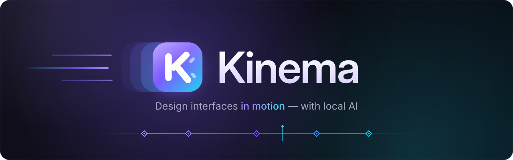
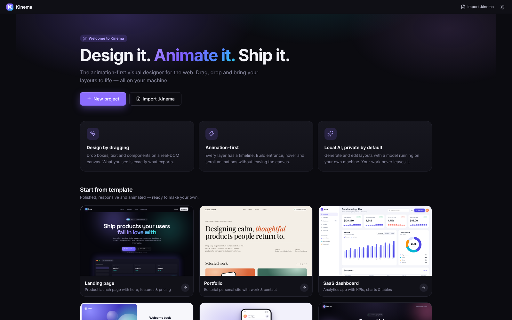
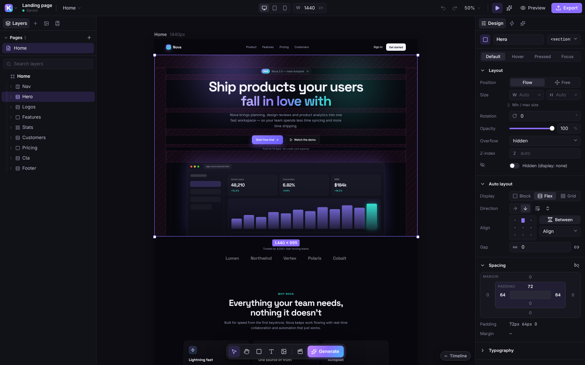
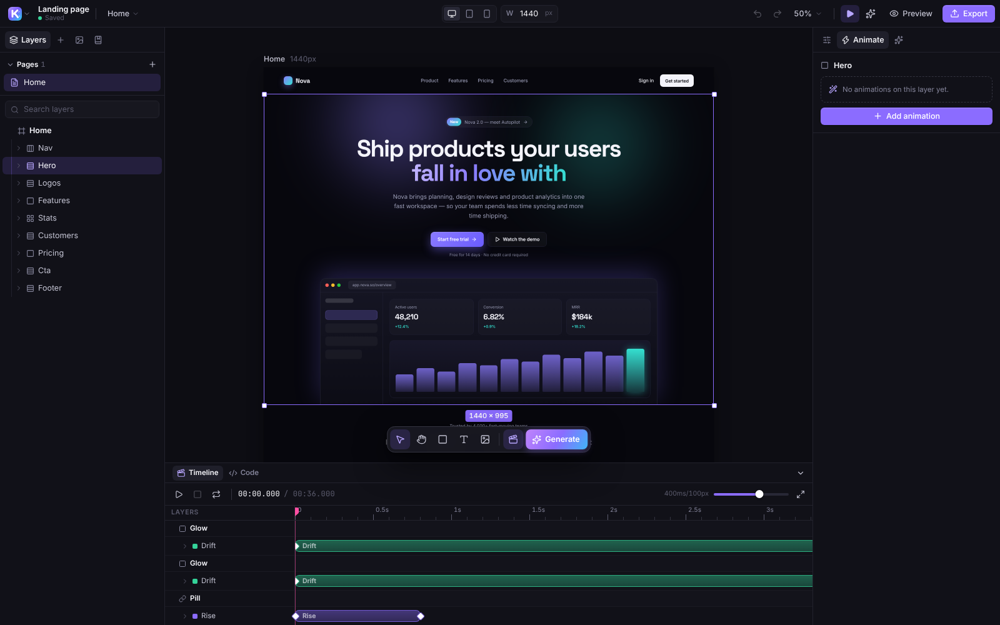

<div align="center">



<p>
  <a href="https://github.com/Temp0o/Kinema/actions/workflows/ci.yml"></a>
  <a href="LICENSE"></a>
  <a href="#download-and-install"></a>
  <a href="https://www.electronjs.org/"></a>
  <a href="docs/OLLAMA.md"></a>
</p>

<p>
  <a href="#download-and-install"><b>Download</b></a> ·
  <a href="#quick-start-for-developers"><b>Build from source</b></a> ·
  <a href="docs/OLLAMA.md"><b>Local AI</b></a> ·
  <a href="docs/USER_GUIDE.md"><b>User guide</b></a> ·
  <a href="CONTRIBUTING.md"><b>Contributing</b></a>
</p>

</div>

**Kinema** is a desktop app for designing user interfaces visually, with motion built in
from the start. Drag components onto a real-DOM canvas, style them with a full properties
panel, and animate them by dragging presets onto elements or shaping keyframes on a
timeline. A built-in AI assistant runs **entirely on your machine through
[Ollama](https://ollama.com)**: it generates pages, sections, components, animations and
SVG logos in your project's style, with no account, no cloud and no API keys. When you're
done, export clean, standalone HTML/CSS/JS that looks exactly like your canvas.

> [!NOTE]
> **Project status: early (v0.1), under active development.** Expect rough edges and
> breaking changes to the project format before 1.0. Bug reports and ideas are very welcome.

## Screenshots

<p align="center">
  
  
</p>
<p align="center">
  
</p>

## Highlights

**🎨 Visual canvas**
- Drag & drop onto desktop, tablet, mobile or custom-size frames
- Move, resize and rotate with snapping and smart guides
- Multi-select, deep undo/redo history, layers panel with grouping, locking and hiding

**🧩 Components & library**
- Searchable component catalog: sections, navigation, cards, forms, media and more
- Turn any selection into a reusable component, then edit the master to update every instance
- Personal library shared across all your projects (components, animations, SVGs, images, palettes, styles)

**✨ Animation-first**
- Preset library with **hover-to-preview**: presets play live on your own design
- Drag an animation onto any element to apply it
- Keyframe timeline with easing and spring curves, stagger and SVG draw-on effects
- Triggers: on load, on scroll into view, on hover, on click, or looping

**🤖 Local AI (Ollama)**
- Auto-detects your installed models and recommends the best one for each task
- Matches your existing style, a preset style, or starts fresh
- Generates pages, sections and components, and edits a selection from a plain-language request
- Generates animations and SVG logos
- Streams a live preview while it works; every AI change is a single, one-click undo

**🎛️ Full styling control**
- Colors, gradients, typography, spacing, borders, shadows, flex and grid layout
- Responsive overrides per breakpoint, hover and pressed states, transitions

**🚀 Preview & export**
- Live preview at any device width
- Export clean standalone HTML/CSS/JS as a single file, a folder or a zip
- Export a single component, or copy its code

**💾 Projects**
- Autosave, templates, portable `.kinema` project files
- Asset manager for images, SVG, fonts and video
- Works offline: fonts are bundled and nothing leaves your machine

## Download and install

Grab the latest build from the **[Releases page](https://github.com/Temp0o/Kinema/releases)**.

| Platform | File | Notes |
|---|---|---|
| **Windows** (x64) | `Kinema-<version>-x64-nsis.exe` | Installer: Start menu and desktop shortcuts, `.kinema` file association, uninstaller. You can choose the install folder. |
| | `Kinema-<version>-portable.exe` | Portable: no installation. Run it from anywhere, including a USB drive. |
| **macOS** | `Kinema-<version>-<arch>.dmg` | Open the image and drag Kinema to *Applications*. |
| **Linux** | `Kinema-<version>-<arch>.AppImage` | `chmod +x` the file, then run it. |

> [!IMPORTANT]
> Builds are not code-signed yet. On Windows, SmartScreen may show
> *"Windows protected your PC"*: click **More info → Run anyway**. On macOS, right-click the
> app and choose **Open** the first time. The [installation guide](docs/INSTALL.md) covers
> every platform in detail, including uninstalling and updating.

## Quick start for developers

**Prerequisites:** [Node.js](https://nodejs.org) **≥ 22.12** (or **^20.19**), npm (bundled
with Node) and [Git](https://git-scm.com). A version manager can read the version from
[`.nvmrc`](.nvmrc).

```bash
git clone https://github.com/Temp0o/Kinema.git
cd Kinema
npm install
npm run dev
```

| Command | What it does |
|---|---|
| `npm run dev` | Start the Electron app with hot reload (F12 opens DevTools) |
| `npm run dev:web` | Run the editor in your browser at `http://localhost:5173` (data is stored in IndexedDB) |
| `npm test` | Run the unit tests (Vitest) |
| `npm run typecheck` | Type-check the whole project |
| `npm run build` | Type-check, then build the renderer (`dist/`) and Electron main/preload (`dist-electron/`) |
| `npm run dist` | Build the Windows installer and portable `.exe` into `release/` |
| `npm run dist:all` | Build every configured package for the current OS (Windows: installer + portable, macOS: `.dmg`, Linux: AppImage) |

See **[docs/INSTALL.md](docs/INSTALL.md#building-from-source)** for a step-by-step Windows
setup and troubleshooting, and **[CONTRIBUTING.md](CONTRIBUTING.md)** before opening a pull request.

## Local AI setup

Kinema's AI features run on [Ollama](https://ollama.com), a free local model runner.

1. Install Ollama from **[ollama.com/download](https://ollama.com/download)** and make sure it is running.
2. Pull at least one model, for example a small coding model:
   ```bash
   ollama pull qwen2.5-coder:7b
   ```
3. Open the **AI** tab in Kinema. Installed models are detected automatically, and each task
   (UI generation, edits, SVG/logos, animation) shows a **Recommended** model you can override.

Which model fits your hardware, vision models for style matching, and troubleshooting are all
covered in **[docs/OLLAMA.md](docs/OLLAMA.md)**.

## Keyboard shortcuts

On macOS, use <kbd>⌘</kbd> instead of <kbd>Ctrl</kbd> and <kbd>⌥ Option</kbd> instead of <kbd>Alt</kbd>.

| Shortcut | Action |
|---|---|
| <kbd>Ctrl</kbd>+<kbd>K</kbd> | Command palette: search every command |
| <kbd>Ctrl</kbd>+<kbd>Z</kbd> / <kbd>Ctrl</kbd>+<kbd>Shift</kbd>+<kbd>Z</kbd> | Undo / redo |
| <kbd>Ctrl</kbd>+<kbd>D</kbd> | Duplicate selection |
| <kbd>Ctrl</kbd>+<kbd>G</kbd> | Group selection (<kbd>Ctrl</kbd>+<kbd>Shift</kbd>+<kbd>G</kbd> to ungroup) |
| <kbd>Ctrl</kbd>+<kbd>I</kbd> | Ask AI |
| <kbd>Ctrl</kbd>+<kbd>E</kbd> | Export |
| <kbd>Shift</kbd>+<kbd>Space</kbd> | Play / stop page animations |
| <kbd>Alt</kbd>+<kbd>T</kbd> | Show / hide the timeline |
| <kbd>V</kbd> <kbd>H</kbd> <kbd>B</kbd> <kbd>T</kbd> <kbd>I</kbd> | Select, Hand, Box, Text and Image tools |
| <kbd>Ctrl</kbd>+<kbd>/</kbd> | Show all keyboard shortcuts |

## Where your data lives

| | Location |
|---|---|
| Projects | `Documents/Kinema/Projects/<project-id>/` (`project.json`, `meta.json`, thumbnail and `assets/`) |
| Personal library | `Documents/Kinema/Library/library.json` |
| Deleted projects | `Documents/Kinema/.trash/`, so you can recover them |
| Browser mode (`npm run dev:web`) | The browser's IndexedDB (database `kinema`) |

On Windows that is `%USERPROFILE%\Documents\Kinema` (or your OneDrive *Documents* folder if
it is redirected). Set the `KINEMA_DATA_DIR` environment variable to store everything
somewhere else. The **Settings** dialog shows the folder in use.

## Project structure

```text
electron/        Electron main process and preload (window, storage, file dialogs, local AI bridge)
src/
  app/           App shell: title bar, panels, feature module registry
  core/          Document model, stores and undo history, styles, animation compiler, HTML import
  features/      Feature modules: canvas, layers, insert, properties, animation, ai, export, …
  platform/      PlatformAPI with Electron (file system) and web (IndexedDB) implementations
  ui/            Design-system primitives (buttons, fields, popovers, dialogs, menus)
tests/           Unit tests (Vitest), browser and Electron smoke tests (Playwright)
scripts/         Dev runner, Electron bundler, icon generator
build/           App icons and packaging resources
docs/            Architecture notes, guides and artwork
```

How the pieces fit together, and the rules every change follows, are in
**[docs/ARCHITECTURE.md](docs/ARCHITECTURE.md)**.

## Tech stack

[Electron](https://www.electronjs.org/) ·
[React 19](https://react.dev/) ·
[TypeScript](https://www.typescriptlang.org/) ·
[Vite](https://vite.dev/) ·
[Zustand](https://zustand.docs.pmnd.rs/) + [Immer](https://immerjs.github.io/immer/) (state and patch-based undo) ·
[Radix UI](https://www.radix-ui.com/) ·
[CodeMirror 6](https://codemirror.net/) ·
[Lucide](https://lucide.dev/) icons ·
[Vitest](https://vitest.dev/) ·
[electron-builder](https://www.electron.build/) ·
[Ollama](https://ollama.com/) for local AI

## Documentation

- [Installation guide](docs/INSTALL.md): installers, portable build, building from source, troubleshooting
- [User guide](docs/USER_GUIDE.md): a tour of the editor, animations, AI and export
- [Local AI with Ollama](docs/OLLAMA.md): models, hardware, settings, troubleshooting
- [Architecture](docs/ARCHITECTURE.md) and [progress log](docs/PROGRESS.md)
- [Changelog](CHANGELOG.md)

## Contributing

Contributions are welcome: bug reports, feature ideas, docs and code. Please read
**[CONTRIBUTING.md](CONTRIBUTING.md)** for the development setup, conventions and the
pull-request checklist. For anything larger than a small fix, open an issue first so we can
agree on the approach.

## License

Kinema is released under the [MIT License](LICENSE). © 2026 Kinema contributors.
